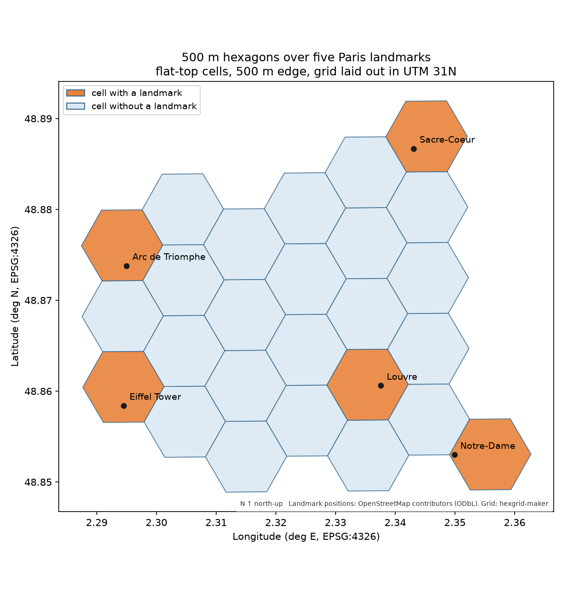

# Showcase: 500 m hexagons over five Paris landmarks

## Question

How many 500 m hexagons are needed to cover the area spanned by five well-known Paris landmarks, and which cells hold a landmark?

## Data

`data/paris_landmarks.geojson`: five points (Eiffel Tower, Arc de Triomphe, Louvre, Notre-Dame, Sacre-Coeur) as WGS 84 longitude/latitude, rounded to 4 decimals (about 10 m).

- Source: landmark positions from OpenStreetMap, https://www.openstreetmap.org/ ; the same file is kept in this repository as `examples/paris_landmarks.geojson`.
- License: ODbL 1.0, © OpenStreetMap contributors, https://www.openstreetmap.org/copyright
- Date fetched: the file was committed to this repository before the showcase (see `examples/README.md`); it was copied here on 2026-11-21 and was not re-downloaded. Positions are approximate.

## Method

```python
from hexgrid_maker import hex_grid, load_geometry

hull = load_geometry("showcase/data/paris_landmarks.geojson")  # convex hull, EPSG:4326 (lon, lat)
grid = hex_grid(hull, 500, orientation="flat")                  # 500 m edge, flat-top
```

- Input CRS: EPSG:4326, axis order longitude, latitude.
- The grid is laid out in the local UTM zone (31N, EPSG:32631), so the 500 m size is in metres; each cell is reprojected to EPSG:4326 and its area measured on the WGS 84 ellipsoid (`area_m2`).
- `make_showcase.py` then marks each cell that covers a landmark (`landmarks`, `n_landmarks`). Hull area is measured with `pyproj.Geod`.
- Output `map.geojson` is EPSG:4326, RFC 7946 order.

## Results

- 26 cells cover the hull of the five landmarks.
- Each cell is 0.650 km² (649,996 to 650,003 m² geodesic; a perfect 500 m hexagon is 649,519 m², the difference is under 0.1 % from the UTM scale factor).
- The 26 cells total 16.90 km² against 10.46 km² for the hull itself, because edge cells reach beyond the hull.
- Each of the five landmarks falls in its own cell (5 of 26 cells hold one), so none of the landmarks shares a 500 m cell.



## Links

- Web map: [index.html](index.html) (Leaflet with OpenStreetMap tiles; needs internet for tiles and when served over http, e.g. `python -m http.server` in this folder, because it fetches `map.geojson`)
- Notebook: [showcase.ipynb](showcase.ipynb)
- Data: [map.geojson](map.geojson)

## Rebuild

```
python showcase/make_showcase.py
```

Runs offline from `data/`. The notebook is executed with `python -m jupyter nbconvert --to notebook --execute --inplace showcase/showcase.ipynb`.

## Limitations

Only five points, a small area; the grid is not aligned to any external grid (its origin is the lower-left of the hull's bounding box).
